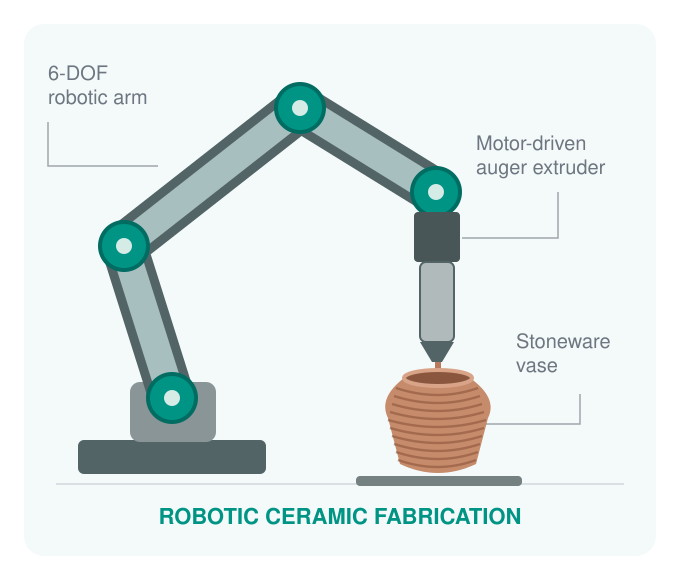
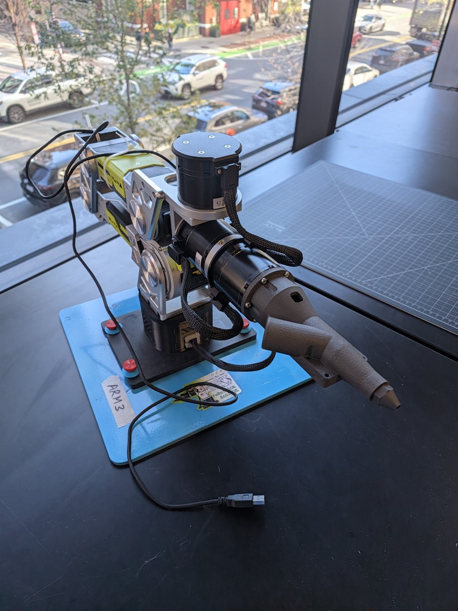

# ReBot prints Clay

**Turning the Seeed Studio reBot Arm B601-RS into a clay 3D printer — open hardware & software documentation.**

Community documentation for setting up and using the **Seeed Studio reBot Arm B601-RS** (6 joints + gripper, RobStride motors, CAN bus), written during *Fabricademy — Week 11: Open Source Hardware*.

The repository is intended to serve as a living, open-source resource covering:

- Robotic arm hardware and software configuration
- Motion control and trajectory generation
- Clay extrusion mechanism
- Mechanical design and end-effector development
- 3D printable components and CAD files
- System integration and experimentation
- Troubleshooting and lessons learned

Through this project, we hope to make robotic ceramic fabrication more accessible, reproducible, and adaptable within the global Fab Lab and maker community.

> This is an unofficial, community project. The official source of truth is the [Seeed Studio wiki](https://wiki.seeedstudio.com/rebot_b601_rs_getting_started/) and the [reBot-DevArm repository](https://github.com/Seeed-Projects/reBot-DevArm).

<p align="center">

</p>

## Current status — arm modification

**As of 2026-11-24, 13:55 EST:** the printed clay extruder body (with side feed inlet and nozzle) is mounted on the reBot B601-RS wrist. Not yet tested with clay.

<p align="center">

</p>

### Progress — as of 2026-11-24, 16:18 EST

What we've done so far:

- ✅ **Mac set up and talking to the arm:** Miniforge + MotorBridge, PCAN-USB driver (PCBUSB). All 7 RobStride motors answer on the CAN bus.
- ✅ **Calibration:** zero calibration and motor parameters in MotorBridge Studio. Per-motor zero re-set after swapping arms.
- ✅ **Teleoperation** with the reBot Arm 102 leader arm in SenseCraft Robotics.
- ✅ **Motor 7 (auger drive) tests:** 90° turn, a full 360° revolution, and a **continuous 30 s spin at 7.5 RPM (≈ 3.9 turns)**, run from our own Python script. **We can now run auger spin tests.**
- 🔜 Next: spin the auger with clay off the arm (flow vs. RPM), then arm path tests (`circle_test.py`) and synchronised extrusion.

Scripts and how to run them: [software/](software/). Full status log: [docs/03-clay-extruder.md](docs/03-clay-extruder.md#status-log).

## Contents

| Doc | What's inside |
|---|---|
| [docs/01-getting-started.md](docs/01-getting-started.md) | Kit contents, safety, assembly overview, wiring, power, CAN setup |
| [docs/02-software.md](docs/02-software.md) | SenseCraft Robotics (no-code), MotorBridge, calibration, LeRobot, ROS 2 |
| [docs/03-clay-extruder.md](docs/03-clay-extruder.md) | Auger extruder end-effector: parts, coupler iterations, CAD review, open questions |
| [docs/04-troubleshooting.md](docs/04-troubleshooting.md) | Common problems and fixes |
| [software/](software/) | Python scripts: motor 7 test, home, circle path test |
| [hardware/](hardware/) | Printable files we designed (auger couplers) |
| [images/](images/) | Build photos |

## At a glance

| | |
|---|---|
| Arm | reBot Arm B601-RS (RS = RobStride motor version; a Damiao "DM" version also exists) |
| Joints | 6-DOF arm + gripper → motors ID 1–7 |
| Bus | CAN, 1 Mbps, via USB-CAN (PCAN-compatible) adapter, SocketCAN `can0` on Linux |
| Power | 48 V / 12.5 A supply (XT30). Not included in every kit — check your SKU |
| Leader arm (teleop) | reBot Arm 102, USB-C serial, 12 V / 2 A |
| Software | SenseCraft Robotics (Win/macOS, no-code) · MotorBridge (Python) · LeRobot · ROS 2 Jazzy/Humble |
| Upstream hardware license | CERN-OHL-W-2.0 ([reBot-DevArm](https://github.com/Seeed-Projects/reBot-DevArm)) |

## Quick start (TL;DR)

```bash
# 1. Python env (Miniforge/conda)
conda create -y -n rebot python=3.12
conda activate rebot
pip install motorbridge

# 2. Bring up CAN (Linux, PCAN-USB)
sudo ip link set can0 down 2>/dev/null
sudo ip link set can0 type can bitrate 1000000
sudo ip link set can0 up

# 3. Check that all 7 motors answer
motorbridge-cli scan --vendor robstride --channel can0 --start-id 1 --end-id 7 --timeout-ms 300
```

Then zero-calibrate and write default parameters in [MotorBridge Studio](https://motorbridge.github.io/motorbridge-studio/) — see [docs/02-software.md](docs/02-software.md).

## Upstream resources

- Seeed wiki — [Getting started](https://wiki.seeedstudio.com/rebot_b601_rs_getting_started/) · [LeRobot](https://wiki.seeedstudio.com/rebot_arm_b601_rs_lerobot/) · [ROS 2](https://wiki.seeedstudio.com/rebot_arm_b601_rs_ros2_integration/) · [SenseCraft Robotics](https://wiki.seeedstudio.com/sensecraft_robotics_rebot_arm_102_b601_rs/)
- Hardware, BOM, CAD — [Seeed-Projects/reBot-DevArm](https://github.com/Seeed-Projects/reBot-DevArm)
- ROS 2 — [reBotArmController_ROS2](https://github.com/Seeed-Projects/reBotArmController_ROS2) · Python SDK [reBotArm_control_py](https://github.com/Seeed-Projects/reBotArm_control_py)
- LeRobot — [Seeed fork](https://github.com/Seeed-Projects/lerobot) · [B601 robot plugin](https://github.com/Seeed-Projects/lerobot-robot-seeed-b601) · [Arm 102 teleop plugin](https://github.com/Seeed-Projects/lerobot-teleoperator-rebot-arm-102)

## Team

Built by a Fabricademy 2027 team:

- Jinger Zeng — [@jinger26](https://github.com/jinger26)
- [Myles Lack-Zell](https://gitlab.fabcloud.org/academany/fabricademy/2027/students/myles-zell)
- [Prapawit Intun Pam](https://gitlab.fabcloud.org/academany/fabricademy/2027/students/prapawit-pam)
- [Kim Ducharme](https://class.textile-academy.org/2026/kim-ducharme/)

## Contributing

Issues and pull requests are welcome — especially corrections from people running the arm on different OSes, and alternative end-effectors.

## License

Hardware files: [CERN-OHL-W-2.0](LICENSE-HARDWARE) · Docs & photos: [CC BY 4.0](LICENSE-DOCS). See [LICENSE](LICENSE). The reBot STEP file is © Seeed Studio, CERN-OHL-W-2.0.
