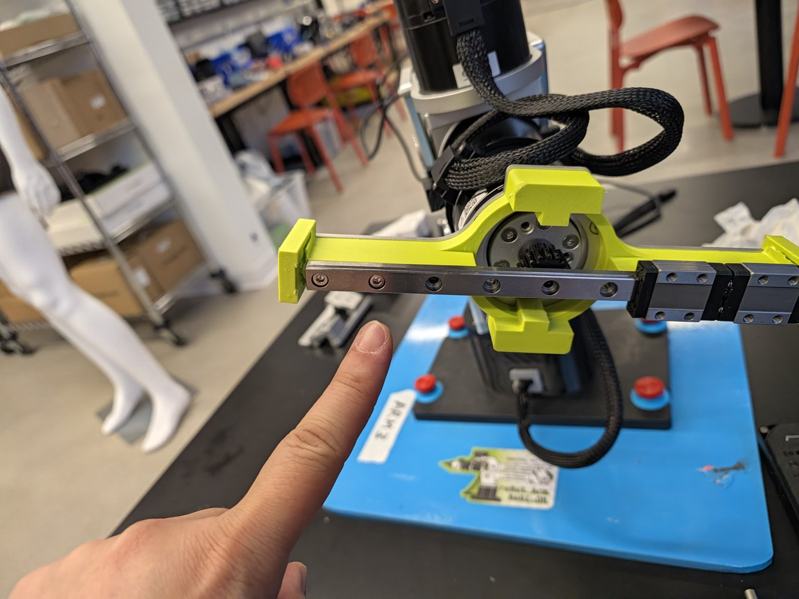
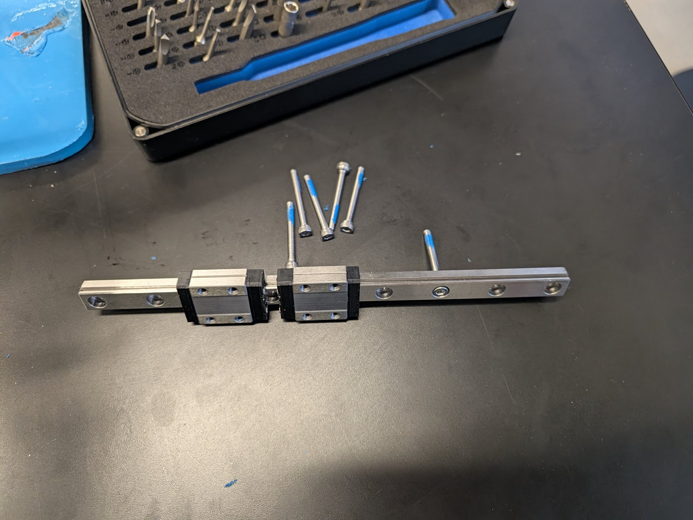
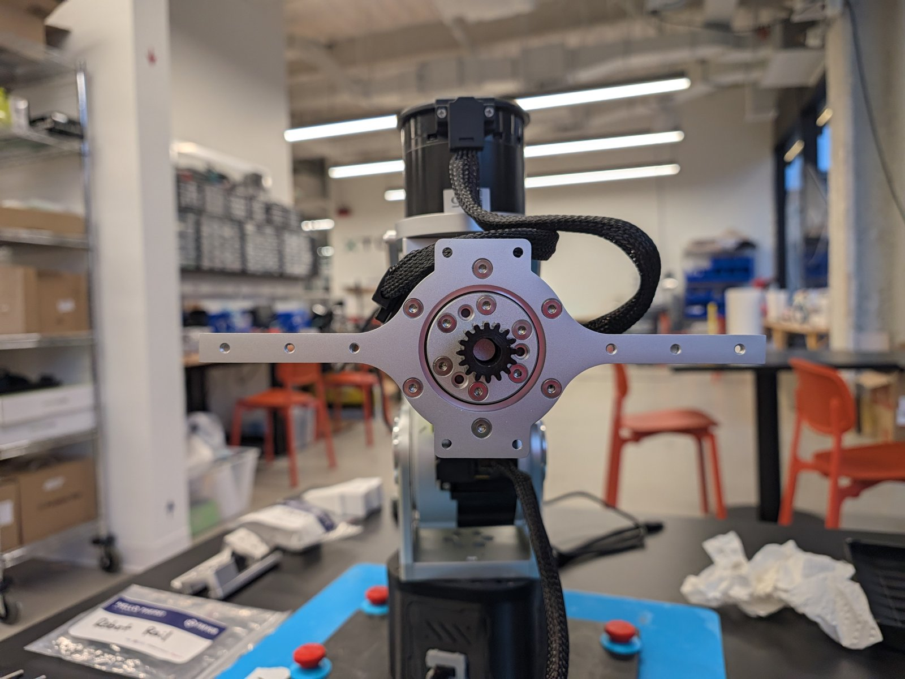
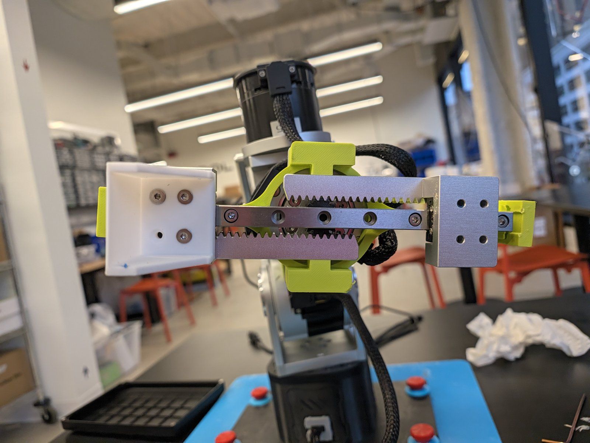
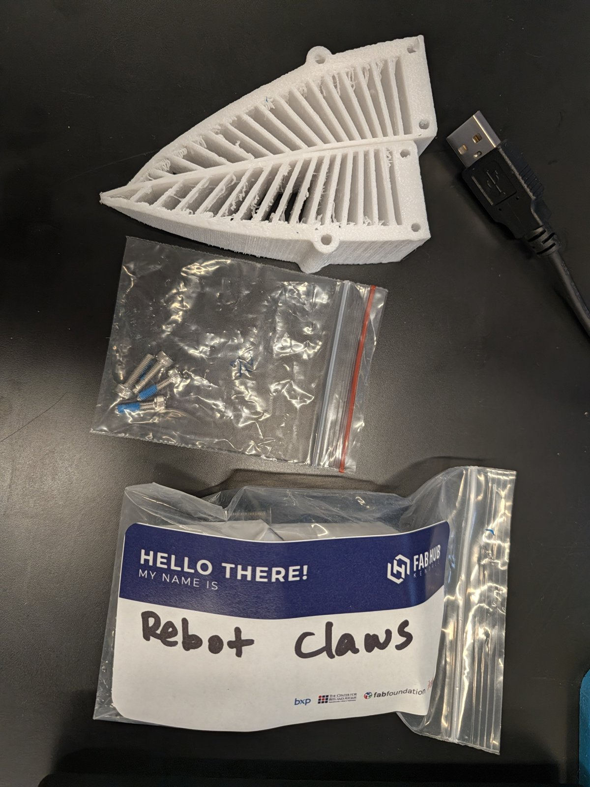
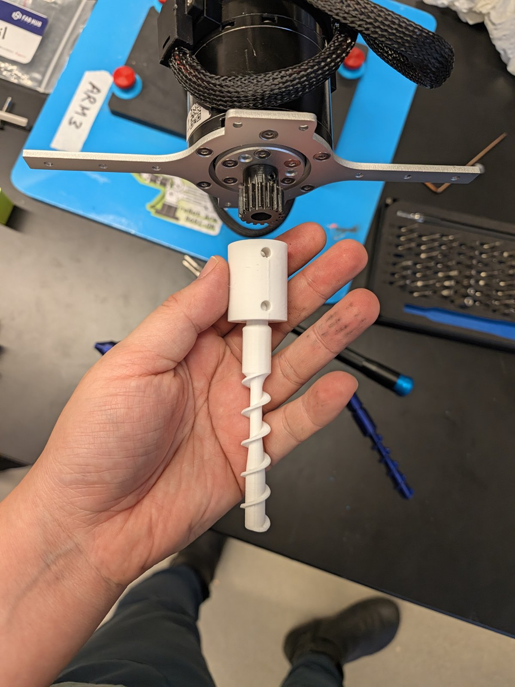

# 01 · Getting started: hardware, wiring & CAN

Condensed from the [Seeed wiki quick start](https://wiki.seeedstudio.com/rebot_b601_rs_getting_started/). Check the wiki for diagrams and the assembly video.

## What's in the box

**Follower arm (reBot Arm B601-RS)** — assembled kit or disassembly kit:

- reBot B601-RS arm + gripper
- USB-CAN driver board (PCAN-compatible) and signal/power separation board
- USB extension cable, 2-pin and 3-pin JST cables
- XT30 2+2 cable, XT30 power cable
- 2 × G-clamps
- 48 V / 12.5 A power supply — **only in the "with power supply" bundle**

**Leader arm (reBot Arm 102)** — optional, for teleoperation / data collection:
reBot Arm 102, 12 V / 2 A adapter, USB-C data cable, 2 × G-clamps.

**You provide:** a host computer (Ubuntu 24.04 recommended for SDK/ROS; Windows/macOS for SenseCraft Robotics), and 1–2 USB cameras if you want to train policies.

Full BOM (down to every screw) is in [reBot-DevArm](https://github.com/Seeed-Projects/reBot-DevArm).

<p>



</p>

## Safety first

- Power **off** before plugging or unplugging any JST / XT30 connector.
- Clamp the base to the table with both G-clamps; make sure it can't move.
- Keep ≥ 1 m clear around the arm during calibration and first motion.
- The kit uses thread-locked screws. If you use an electric screwdriver, set it to 3–6 kgf·cm.
- If power or signal drops during teleop: stop the program, return the arm to its zero pose, then restart.

## Assembly overview

1. Check each screw size and part orientation before tightening (follow the wiki video).
2. Connect motors 1 and 2.
3. Optional: fit the flexible gripper.
4. Clamp the arm to the table.

<p>



</p>

## Wiring

**Follower — signal:** arm base → XT30 2+2 → separation board → 2-pin cable to USB-CAN board (**red → H, black → L**) → USB extension → PC.
Set the USB-CAN DIP switch to **120R** (termination).

**Follower — power:** arm base → XT30 2+2 → separation board → XT30 power cable → 48 V / 12.5 A supply → outlet.

**Leader — signal:** arm → USB-C → PC (shows up as `/dev/ttyUSB*` on Linux).
**Leader — power:** 12 V / 2 A adapter.

Only plug USB into the PC when you reach the scan step, and switch power on only after checking every cable.

## CAN setup

### Linux (SocketCAN)

```bash
sudo apt install -y build-essential gcc g++ make libpopt-dev can-utils ethtool
sudo apt remove -y brltty        # brltty can grab the leader arm's serial port
```

If your adapter needs the PEAK driver, download `peak-linux-driver-9.2.0.tar.gz` from
[peak-system.com](https://www.peak-system.com/quick/PCAN-Linux-Driver) and build it with
**`make netdev`** (not plain `make` — LeRobot and MotorBridge need SocketCAN):

```bash
make netdev
sudo make install
sudo depmod -a
sudo modprobe pcan
```

Bring the bus up (repeat after every reboot / replug):

```bash
sudo ip link set can0 down 2>/dev/null
sudo ip link set can0 type can bitrate 1000000
sudo ip link set can0 up
```

### macOS

MotorBridge uses the PCBUSB library on macOS. Install
[`macOS_Library_for_PCANUSB_v0.13`](https://raw.githubusercontent.com/tianrking/motorbridge/main/third_party/pcan/macos/macOS_Library_for_PCANUSB_v0.13.tar.gz), then:

```bash
sudo ln -sf /usr/local/lib/libPCBUSB.dylib /usr/local/lib/PCBUSB
export DYLD_FALLBACK_LIBRARY_PATH=/usr/local/lib:$DYLD_FALLBACK_LIBRARY_PATH
```

### Windows

Install the PEAK-System driver package linked from the wiki.

### Firmware recovery (USB-CAN board)

If the adapter has the wrong firmware: set its switch to **BOOT**, flash `USB2CAN` with the wiki's scripts (Ubuntu/macOS) or DfuSe (Windows), then set the switch back to **120R**.

Next: [02 · Software](02-software.md)
