# 03 · Clay / paste extruder end-effector

Work in progress: turning the reBot B601-RS into a clay/paste 3D printer with an auger extruder on the wrist.

> ⚠️ Status: geometry review and fit tests. Nothing here is a load-rated, verified mount yet.

## Status log

| Date / time | Status | Photo |
|---|---|---|
| **2026-11-24, ~16:20–17:01 EST** | ✅ **First extrusion** at Fab Hub Kendall, Cambridge, MA: mashed potato fed by compressed air, auger turned by motor 7 (`--spin`), arm still. See [05 · Mashed potato test](05-mashed-potato-test.md). | 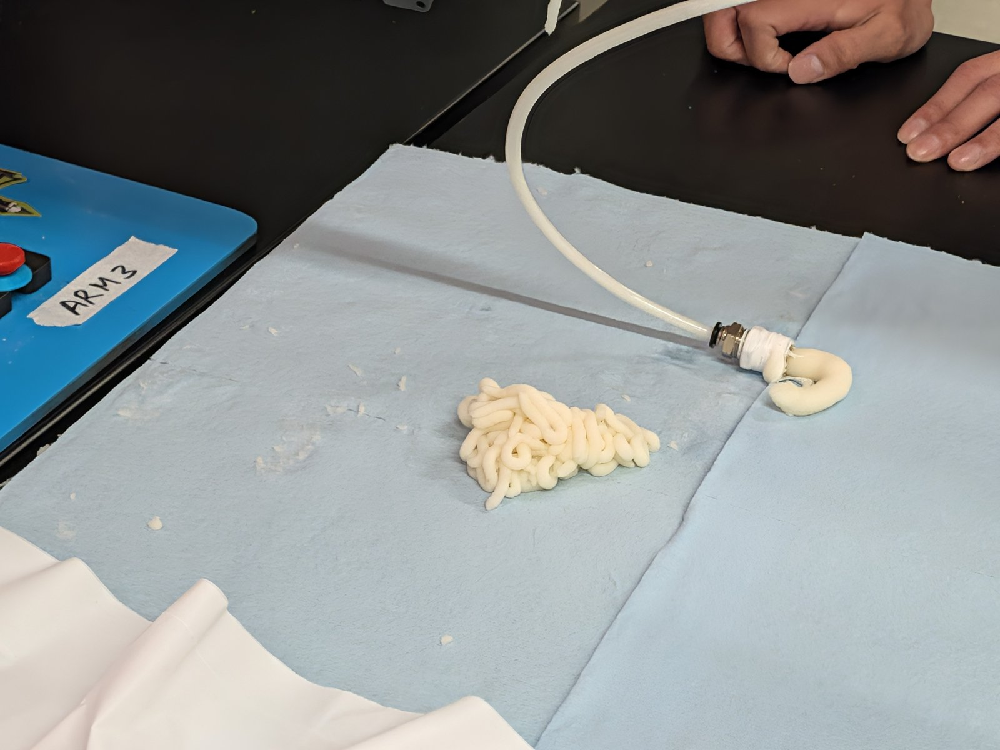 |
| **2026-11-24, 16:18 EST** | Arm connected to a Mac and calibrated, teleop working. Motor 7 (auger drive) tested from [`software/motor7_test.py`](../software/motor7_test.py): 90°, 360°, and a continuous 30 s spin at 7.5 RPM. Ready for auger spin tests. | — |
| **2026-11-24, 13:55 EST** | Printed clay extruder body (side feed inlet + nozzle) mounted on the wrist of ARM3. Not yet tested with clay. | 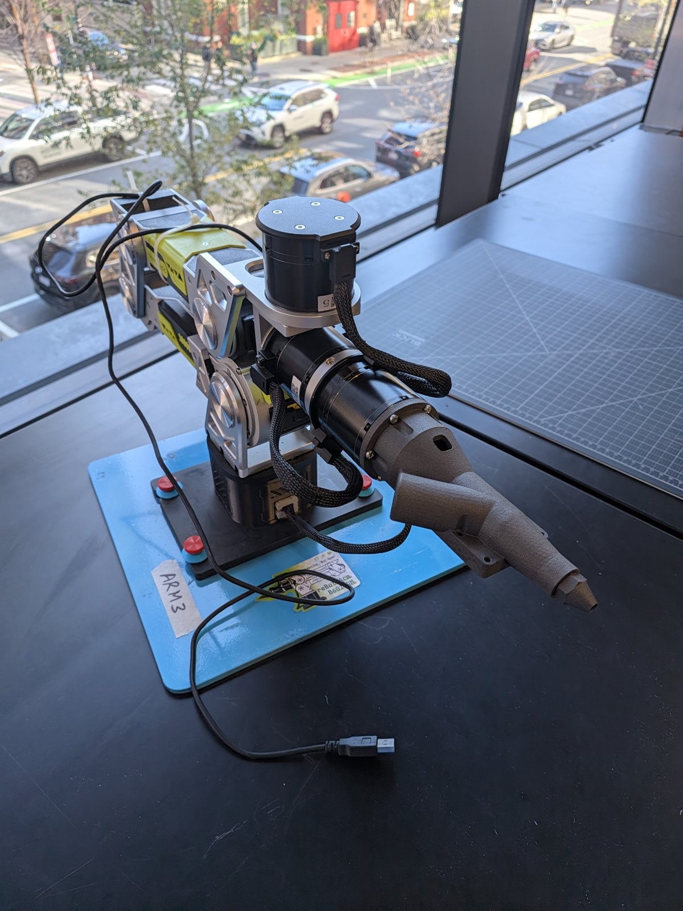 |

## Concept

- An **auger (screw) extruder** at the end of the arm pushes clay/paste through a nozzle.
- Driven by **motor 7**, the arm's own RobStride RS-00 gripper motor, on the same CAN bus as the arm. Arm motion and extrusion can be controlled from one program. (An earlier plan used a separate geared NEMA 17 stepper, `17HS19-1684S-PG5`.)
- The clay reservoir stays **off the arm** and is fed by hose, to keep wrist load low.

## Printed test parts

We printed extruder bodies, augers and mounts in PLA to check fit before ordering a metal auger.

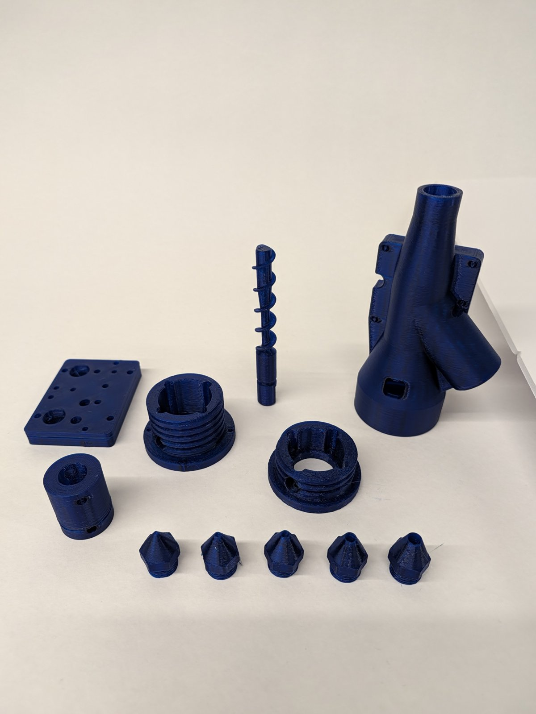
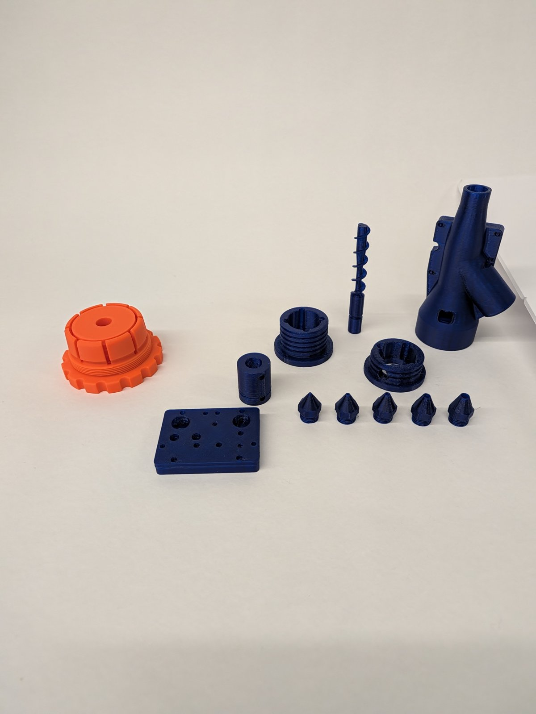
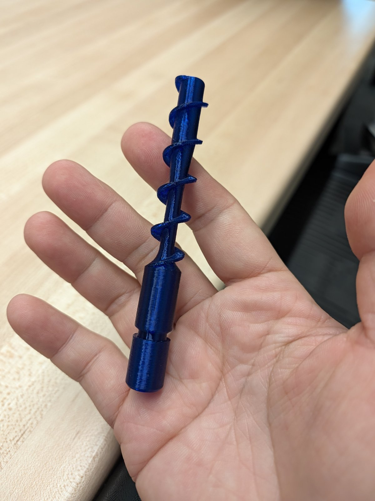

Reference designs we started from (not redistributed here — see original sources):

- A modular paste-printing extruder (adaptor, main body, motor mounts, paste screw, 4 mm nozzle).
- A NEMA 17 clay extruder (housing, auger, nut, motor and fan mounts).

## Auger ↔ motor coupler

> **Status: Jinger v0 — not used.** The couplers below were early explorations and are not part of the current build.

The motor output has a **16-tooth spline**. We designed printed couplers to connect it to the auger, measuring the spline with calipers and iterating on fit.

| File | Notes |
|---|---|
| [`rebot_auger_adapter_v1.stl`](../hardware/auger-coupler/rebot_auger_adapter_v1.stl) | First adapter |
| [`rebot_auger_coupler_v2.stl`](../hardware/auger-coupler/rebot_auger_coupler_v2.stl) | Coupler v2 |
| [`rebot_auger_v3_16T_11mm_auger_coupler_FIT_ONLY.stl`](../hardware/auger-coupler/rebot_auger_v3_16T_11mm_auger_coupler_FIT_ONLY.stl) | 16T spline, 11 mm auger bore — fit test only |
| [`rebot_v4_16T_12mm_auger_coupler_FIT_ONLY.stl`](../hardware/auger-coupler/rebot_v4_16T_12mm_auger_coupler_FIT_ONLY.stl) | 16T spline, 12 mm auger bore — fit test only |

`FIT_ONLY` parts are for checking dimensions, not for carrying load.

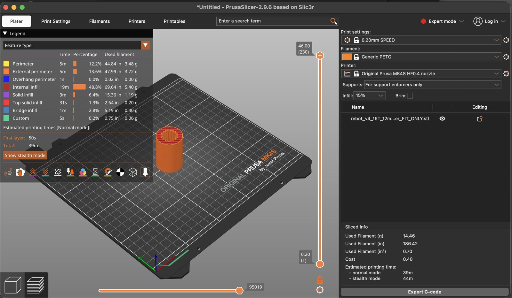
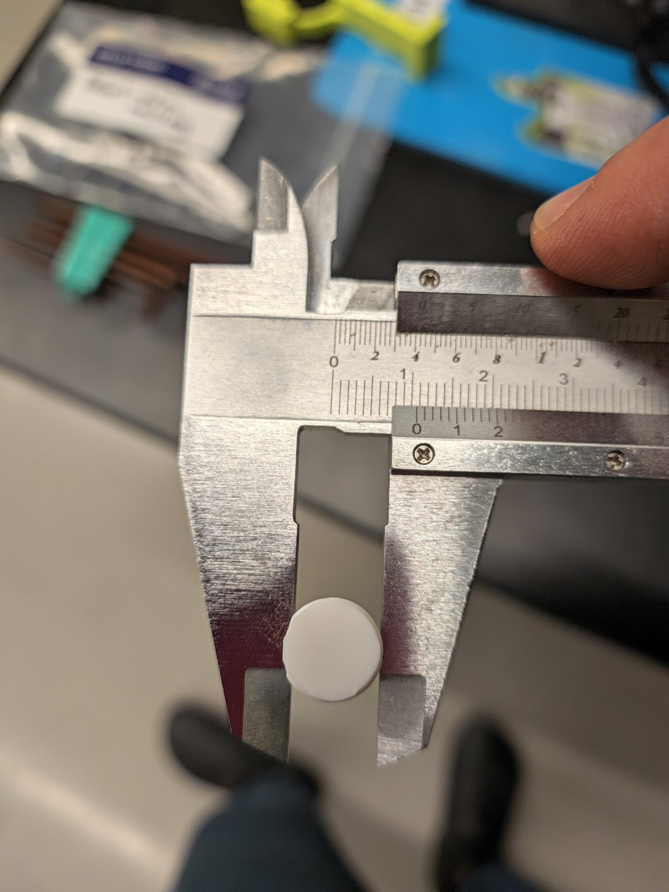

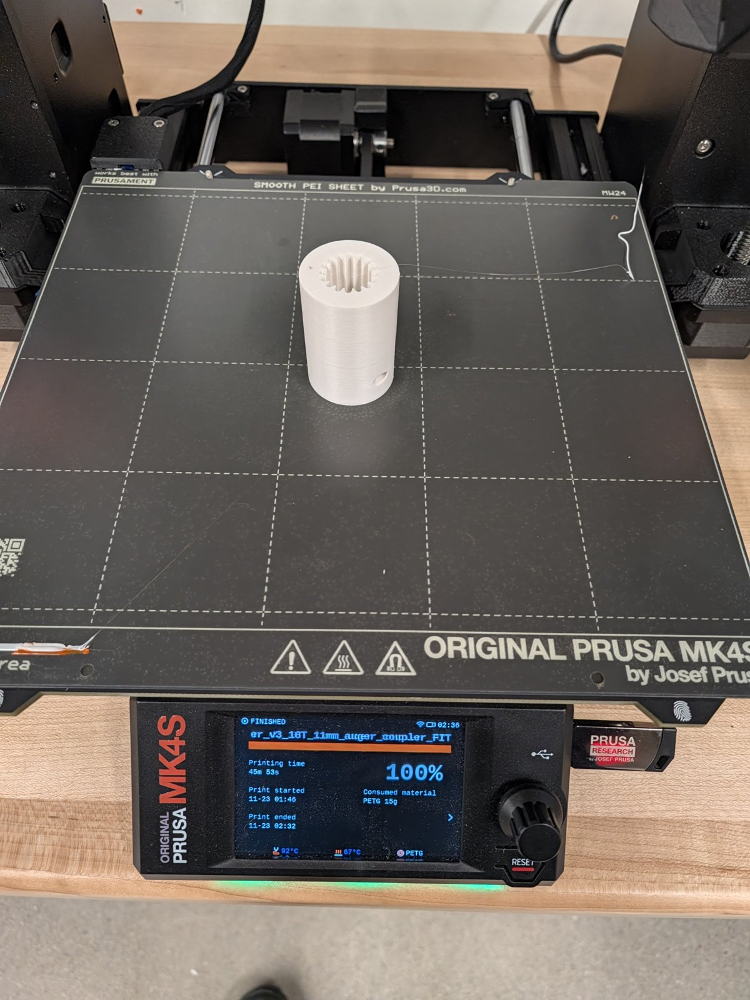
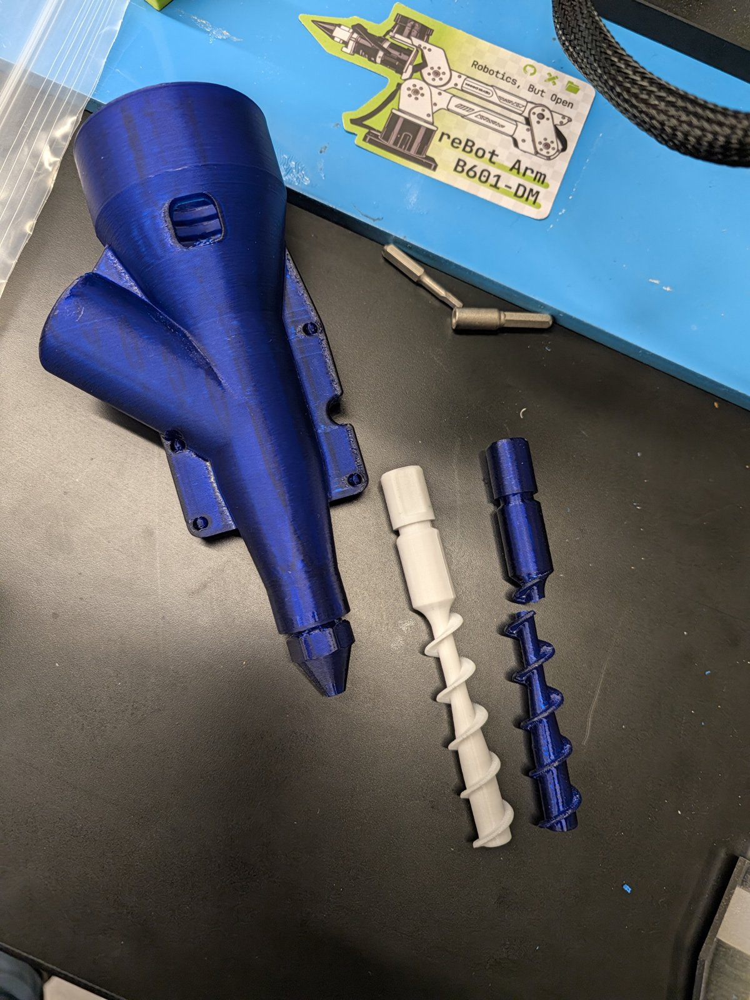
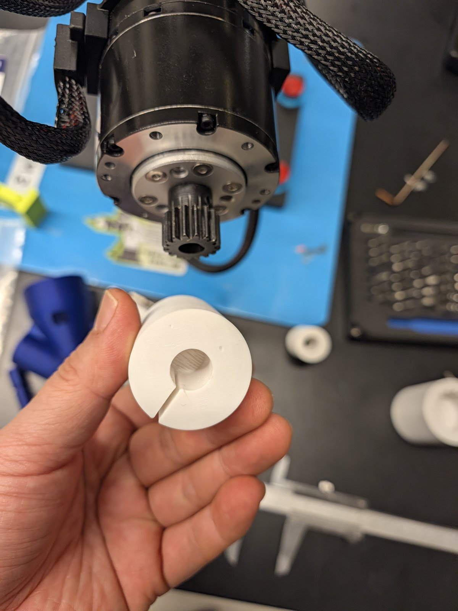

## Measuring the motor

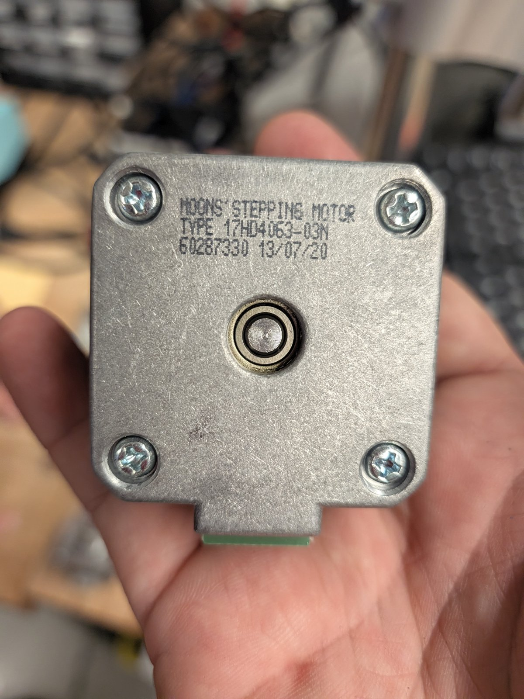
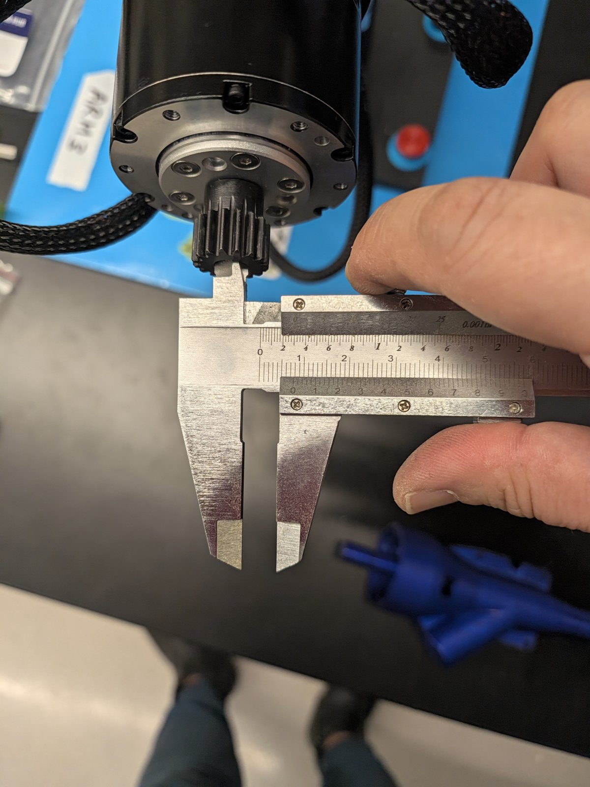
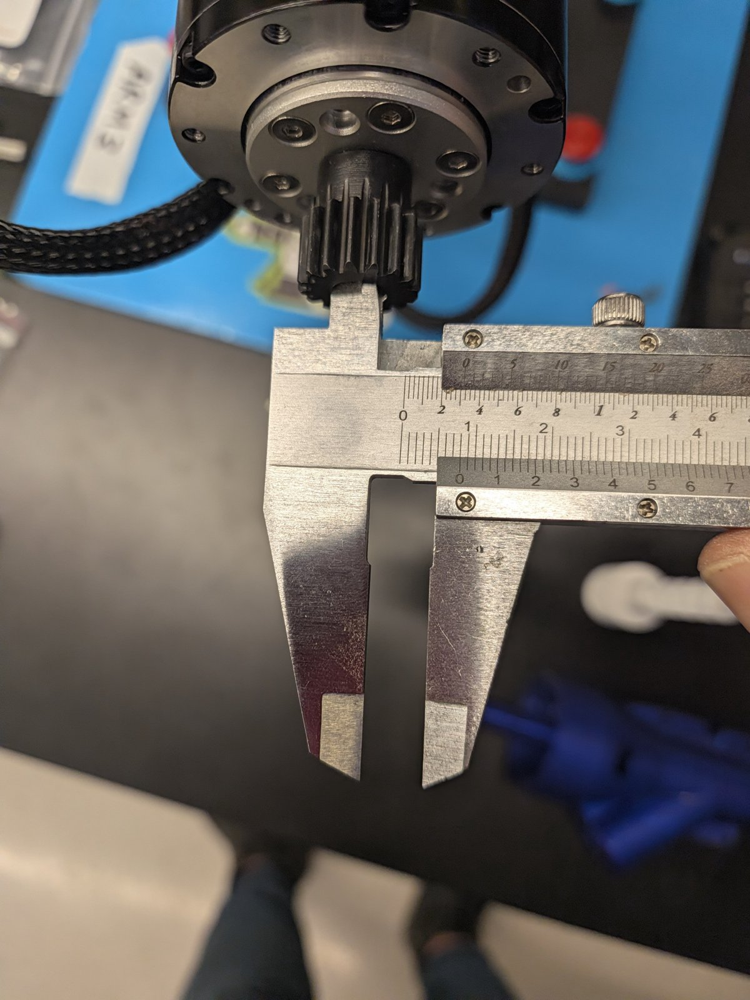

## CAD review (v1)

We loaded Seeed's reBot assembly STEP (`reBot_B601_RS_v1.0_20260625.step`, from [reBot-DevArm](https://github.com/Seeed-Projects/reBot-DevArm); ~370 solids, approx. 561 × 321 × 200 mm overall), the motor STEP, and the extruder STLs.

Findings:

- The extruder STLs aren't in a shared coordinate system, so they don't form an assembly yet.
- The extruder main body mesh isn't watertight; repair it before booleans or manufacturing.
- *(Earlier NEMA 17 plan)* The motor mount for the non-reduction motor may not fit the geared NEMA 17. Check the hole pattern, pilot, shaft and coupler.
- Wrist flange interface, attachment holes and tool center point (TCP) are still unverified.

## Next steps

1. Find the 6th-axis flange in the STEP file and check it against the real arm.
2. Define the extruder body axis, mounting faces and fasteners.
3. Fit motor + coupler + auger; redesign the motor mount if needed.
4. Design and test a flange adapter and support bracket, with the reservoir off the arm.
5. Define nozzle TCP, check clearance and payload, add hose strain relief, dry-run safely.
6. Choose auger material and source: compare a machined stainless steel auger with printed and fabbed options.

Before running clay on the robot: rated hose and fittings, pressure relief, and bench extrusion tests.
